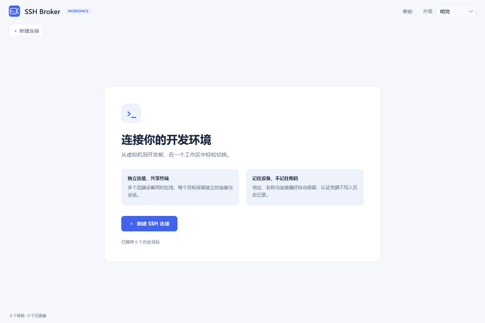
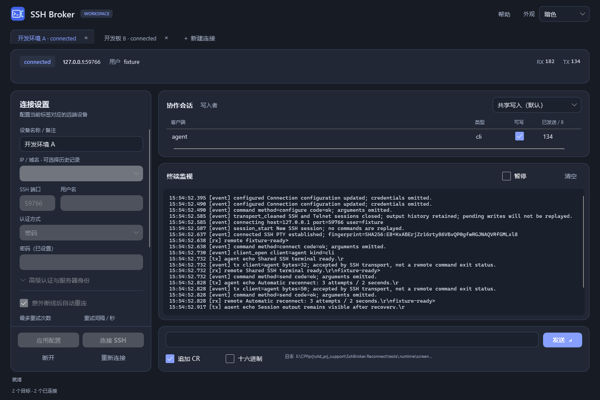

# SSH Broker V2.0.2

[简体中文](README.md) | **English**

A Windows multi-device SSH workspace for virtual machines and Linux boards, sharing each remote terminal between people and automation tools.

[Download V2.0.2](https://github.com/tangzihengtzh/ssh-broker/releases/tag/V2.0.2) · [Usage guide](docs/USER-GUIDE.html) · [API reference](docs/AUTOMATION.md) · [V2.0.0](https://github.com/tangzihengtzh/ssh-broker/releases/tag/V2.0.0) · [V1.0.0](https://github.com/tangzihengtzh/ssh-broker/releases/tag/V1.0.0)

## Product views

Light-theme welcome page:



Dark-theme workspace with two connected targets:



## New in V2.0.2

Fixes repeated connection failures after reinstalling a board at the same IP: the saved host fingerprint became stale, but the GUI offered no direct confirmation to update it.

- When a board is reinstalled and its host key changes, the GUI shows the endpoint and old/new fingerprints for confirmation.
- Accepting replaces the saved trust record and retries once with the retained password. Declining preserves the old record and stops authentication.
- Password authentication does not use a login private key. Server identity verification remains enabled; CLI and automatic recovery never silently accept changed keys.
- Failure logs include expected and observed fingerprints.

## New in V2.0.1

- **Bounded recovery:** an established SSH connection that drops unexpectedly retries up to **3 times**, **2 seconds apart**, by default. Configure or disable this per target.
- **Retained terminals and scrollback:** existing local Telnet sockets are kept during recovery when possible. Late clients receive up to **512 KiB** of recent output; GUI output cursors are retained.
- **No command replay:** offline input is rejected instead of queued. Explicit disconnect, target closure or application exit cancels pending recovery, including an in-progress handshake.
- **Diagnostics:** retain the original disconnect cause, exception type, timestamp, connection duration, RX/TX counters and each retry result, including after successful recovery.
- **Flapping protection:** immediately repeated drops share a retry budget. Authentication failures and host-key mismatches stop recovery rather than looping.

**A recovered SSH connection creates a new remote shell. It does not restore remote processes, working directory, environment or in-flight commands.** Use remote tools such as tmux/screen when remote process continuity is needed.

## Workspace features

- Independent target tabs, SSH sessions, Telnet ports, write policies, output and CLI endpoints.
- Editable host history with names and previous ports, without saved passwords; suggested ports avoid conflicts.
- Rounded ModernWpf UI with Light, Dark, Warm and Blue themes covering the monitor as well as the rest of the interface.
- Remembered window bounds, maximized state and appearance; no automatic connection on startup.
- Close-to-tray operation, an original icon and separate local help. Use the tray menu to actually exit.
- Raw RX/TX and event logs, with GUI and CLI operations sharing one authoritative engine per target.

## Install and upgrade

Download **SshBroker-V2.0.2-win-x64.zip**, extract into a separate folder, install **.NET 8 Desktop Runtime (Windows x64)** if necessary, and run **SshBroker.exe**. Keep all companion DLL, JSON and documentation files. Administrator privileges are not required.

Create a target, enter the endpoint and credentials, and connect. Unknown server identities require first-use confirmation. Terminal clients connect through Telnet to `127.0.0.1` and that target's local port; see **Help** for examples.

At a convenient time, **explicitly exit the old application through its tray menu** before switching versions. Do not overwrite a running installation; live connections cannot be transferred between processes.

The release retains the validated reconnect build's separate workspace: default pipe **SshBrokerReconnect**, settings under `%LOCALAPPDATA%/SshBroker/reconnect-preview/workspace`. It does not attach to a V2.0.0 `SshBrokerV2` instance. History, appearance and window settings persist; passwords stay in process memory.

## Automation

```powershell
./sshctl.exe sessions
./sshctl.exe session-create --name "Linux board"
./sshctl.exe --pipe SESSION_PIPE status
./sshctl.exe --pipe SESSION_PIPE send --text "pwd" --cr
./sshctl.exe --pipe SESSION_PIPE watch
```

Use the returned session pipe, independently of GUI tab selection. Retry options are `configure --reconnect-attempts N --reconnect-delay MS`; zero attempts disables recovery. JSON fields are `reconnectAttempts` and `reconnectDelayMs`.

Snapshots expose `reconnecting`, `autoReconnectActive`, `reconnectAttempt`, `reconnectSuccesses`, `lastDisconnect` and `lastDisconnectAt`. Start headless mode with `SshBroker.Host.exe --workspace true`. CLI SSH configuration requires a verified fingerprint; supply credentials through environment variables or stdin JSON.

See [API documentation](docs/AUTOMATION.md) and [recovery behavior](docs/RECONNECT.md).

## Build and verification

C# / .NET 8, WPF, ModernWpfUI 0.9.6 and SSH.NET 2026.0.0. Build on Windows x64 with .NET SDK 8.0.400 or a compatible newer 8.0.4xx SDK. SSH fixtures require Python 3.10+.

```powershell
python -m pip install -r tests/requirements.txt
./scripts/build-release.ps1
```

Outputs: `artifacts/V2.0.2/app/` and `artifacts/SshBroker-V2.0.2-win-x64.zip`. Previous version tags and releases are preserved; `main` tracks the latest version.

Functional checks cover recovery, retry exhaustion, handshake cancellation, flapping, scrollback, no replay, target isolation and tray lifecycle. See [test results](docs/TEST-RESULTS.md).

SFTP/SCP, jump hosts, SSH agent, interactive MFA and independent shells per downstream client are not included. The GUI monitor escapes control characters; terminal clients handle terminal rendering. Loopback Telnet has no authentication, control pipes are restricted to the current Windows user, and raw terminal logs may contain sensitive content.

## License and contributors

[MIT](LICENSE). OpenAI Codex assisted development and is credited through Git co-author trailers. See [third-party notices](THIRD-PARTY-NOTICES.md).
