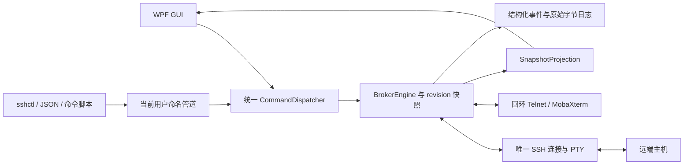

# SSH 代理设计

## 目标和技术选择

沿用串口代理的工作流：人通过 MobaXterm 观察/输入，Agent 通过 CLI 操作，双方共享一个远端交互会话。用户确认下游继续使用本机 Telnet + CLI，上游改为 SSH PTY；本轮必须完成构建和实际测试，包括意外断线、日志和 CLI。

采用 .NET 8 + WPF + SSH.NET 2026.0.0。选择 WPF 是为了用标准布局、数据绑定和异步操作实现界面，避免沿用 Win32 逐控件移动/重绘的实现。SSH.NET 负责加密、认证、PTY 和通道，不自行实现密码协议。初选 2025.1.0 在 NuGet 审计中发现高危公告，因此改用 2026.0.0，未禁用漏洞审计。

工程独立置于 SshBroker，不修改 SerialBroker 的源码和 GitHub 仓库。本轮没有用户指定的真实 SSH 目标，所有自动化测试使用独立回环服务。

## 控制面与数据面

GUI 不直接修改 SSH 客户端对象，不保存另一套权威配置。CLI 与 GUI 调用相同 dispatcher，返回统一成功/失败码及快照；所有可显示的真实配置都来自引擎。GUI 的配置表单可以存在显式草稿，顶部状态始终为服务中的实际值；CLI 更新配置后会覆盖旧草稿并重新同步，防止保留过时显示。

`status`、`projection`、`clients`、`logs` 的结果与响应快照从同一个原子状态读取生成，防止接收字节恰好变化时两者的 revision/计数不一致。GUI 忽略 revision 更旧的响应。同步为轮询最终一致，默认约 250 ms，不声称界面与外部进程同一时刻同步刷新。

## 状态和并发

连接状态为 disconnected → connecting → connected → disconnecting → disconnected；异常进入 faulted。每次新连接增加 generation；权限/连接变化增加发送 epoch。发送入队及真正开始前各检查状态和权限，旧 epoch 请求不可跨策略或跨连接发送。

短状态修改受 `_gate` 保护，配置/连接/断开/尺寸操作由 lifecycle semaphore 串行化，SSH 写操作由独立 send semaphore 串行化。状态查询不等待整个连接操作。断开请求先取消当前连接 token，再等待生命周期锁，因此可以中断正在握手的连接。

上游 ShellStream 使用独立读取循环，持续排空库的接收缓冲，不只订阅 DataReceived 却让内部缓冲无限累积。读到 EOF 将远端 shell 关闭视为故障；SSH 连接错误、写超时和健康检查失败均触发清理。清理先关闭上游传输，使阻塞读写能结束，再关闭 Telnet 会话并回收任务。

每个客户端最大 4096 字节一次发送，最多 128 个等待请求；每个 Telnet 接收端独立有界输出队列，1024 个块或 1 MiB，慢客户端仅断开自己。缓冲上限为正常网络突发与 GC 暂停留出余量，仍不承诺任意速率下的无损转发；队列超限、写超时和对端关闭的原因写入事件日志。Telnet 总计最多 32 个会话，引擎最多登记 64 个逻辑客户端，RPC 同时最多 32 个连接。发送完成是 SSH 层写入确认，不是远端命令返回值；排队中的请求可撤销，已进入写入阶段的块不可撤回。

输出环保存至多 512 项/约 1 MiB，每页编码预算限制为约 512 KiB，以免大量控制字符转义后超过协议行上限。输出有全进程递增 cursor，落后于历史的读取明确返回 lostHistory；Telnet 新客户端独立回放最近最多 64 KiB 的 RX 历史。

## 身份、主机密钥和凭据

支持密码和私钥认证，包括带口令私钥。私钥算法源优先使用现代签名，过滤 RSA/SHA-1 和 DSA：SSH.NET 默认把 ssh-rsa 放在 RSA/SHA-2 前，某些服务器收到不支持的首个请求就关闭认证，真实测试中因此补充了现代算法优先的适配层。

主机密钥必须与配置中的 `SHA256:base64` 精确匹配；未知和变化均拒绝。观测指纹可通过快照读回，但不会自动信任。GUI 会匹配 Windows OpenSSH 的可信记录；未知主机弹出一次信任确认，再通过 dispatcher 设置指纹并连接。连接成功后在 LocalAppData/SshBroker/known-hosts 按主机和端口记住身份，变化的密钥不会自动接受。CLI 仍要求显式指纹。Telnet 监听仅在 SSH 认证与 PTY 创建成功后启动，连接期间不会开放。

CLI 从自身进程环境读取 password-env/passphrase-env，在命名管道请求中提交；服务器不从另一个进程的环境推测凭据。GUI PasswordBox 同样经 dispatcher 更新，快照仅返回 hasPassword/hasKeyPassphrase。事件日志只记录命令名和结果码，不序列化参数；错误信息也对当前认证密码和私钥口令进行遮盖。

本地命名管道使用 CurrentUserOnly，拒绝远程控制；相同用户的其它进程仍可操作服务。Telnet 使用独占 IPv4 回环监听，没有本地身份认证。写入者 ID 是协作标签而非认证身份。

## 健康检查和故障边界

仅发送 SSH keepalive 不能保证发现无响应的半开网络连接。默认每 2 秒通过同一 SSH 连接的新 exec 通道执行 `true`，约 4 秒截止时间；这不会另开远端 PTY，也不会向共享 shell 输入命令。测试服务确认多个本地客户端始终只使用一个 shell。

远端须支持 exec 健康命令；非 POSIX 或受限 SSH 服务可指定其它轻量命令或置空关闭探测。关闭后无响应网络的主动检测保证相应减弱。远端命令返回非零或超时都会 faulted。keepalive/health 参数均通过 configure 可见并可配置。

发生异常时不自动重连、不自动重新认证、不自动重放写入。API 保持可用，返回故障码和错误信息；GUI 显示同一故障状态。手动 reconnect 先清理旧连接，再增加 generation 并新建 SSH 会话。

## 日志

每次连接新建含毫秒、generation、GUID 的目录。events.jsonl 使用 UTC 时间和结构化 kind/message/revision/generation；GUI 将时间换成本地显示。RX/TX 分别保存在二进制文件，发送文件只含完整成功块，失败块可能已部分发出但不假造已知字节数。

各日志文件上限默认 16 MiB，任何写盘错误或超限均停用本会话日志，并通过快照和事件显示原因，转发继续。没有断电原子性或跨文件事务保证。日志按块同步刷新；极慢磁盘仍可能影响接收处理，不声称无限吞吐或无损采集保证。

## GUI 与测试

GUI 可独立持有 Runtime，也可连接已经运行的同名 Host；关闭附着 GUI 不关闭独立 Host。自持 Runtime 的 GUI 退出时清理服务和连接。多个同名服务用当前用户临时目录的独占锁文件防止并存，文件句柄随进程退出释放。

集成测试使用真实 Paramiko SSH 服务、真实 Host/CLI EXE、真实回环 TCP，以及实际 WPF 控件绑定。WPF probe 不 Show 窗口，不抢前台；它检查文本框、状态文字、权限下拉框和 revision 与快照一致。它不等同于人工验收每种 DPI/显示器下的视觉表现。

测试夹具生成独立 SSH 主机密钥、客户端私钥、随机密码和随机回环端口，结束时回收自己的进程和连接；不安装系统服务，不访问真实设备。原始报告和夹具数据放在被忽略的 artifacts/ 与 tests/.runtime/ 中。
